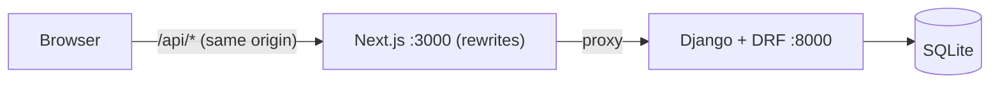
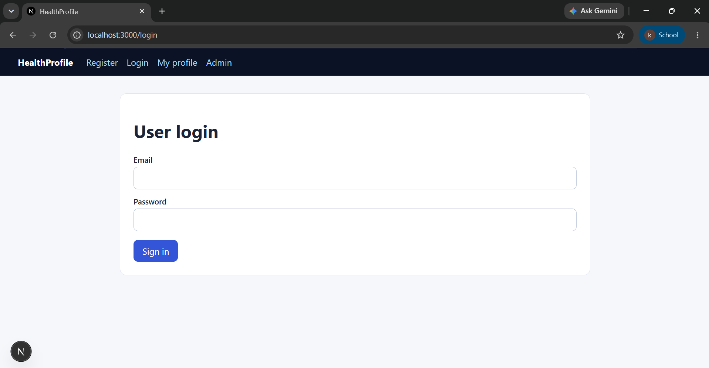
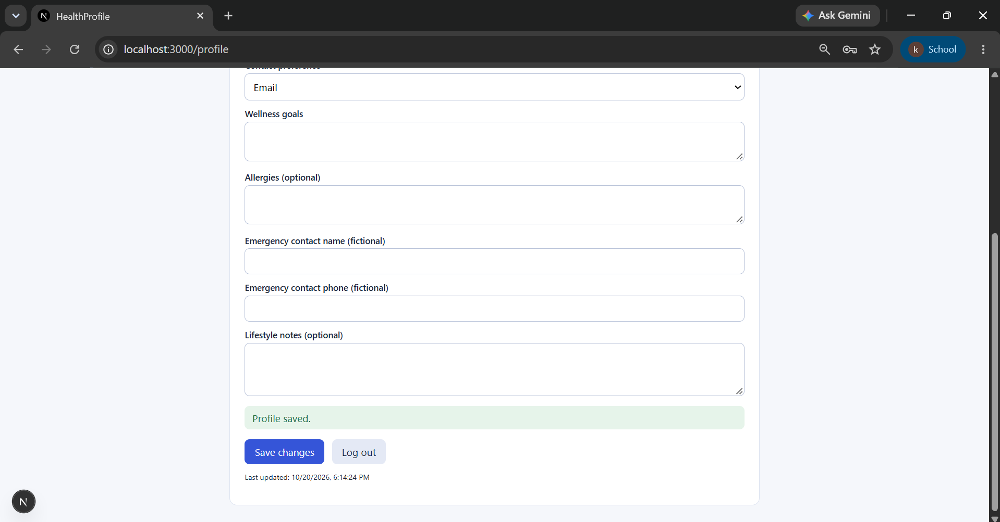
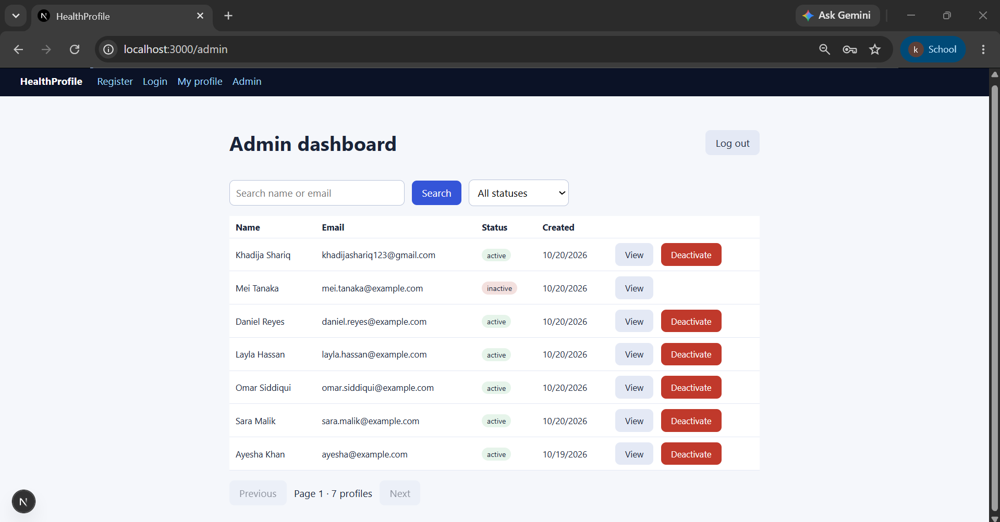
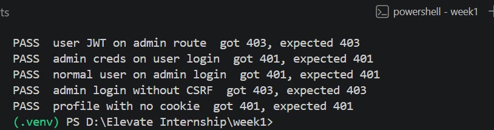
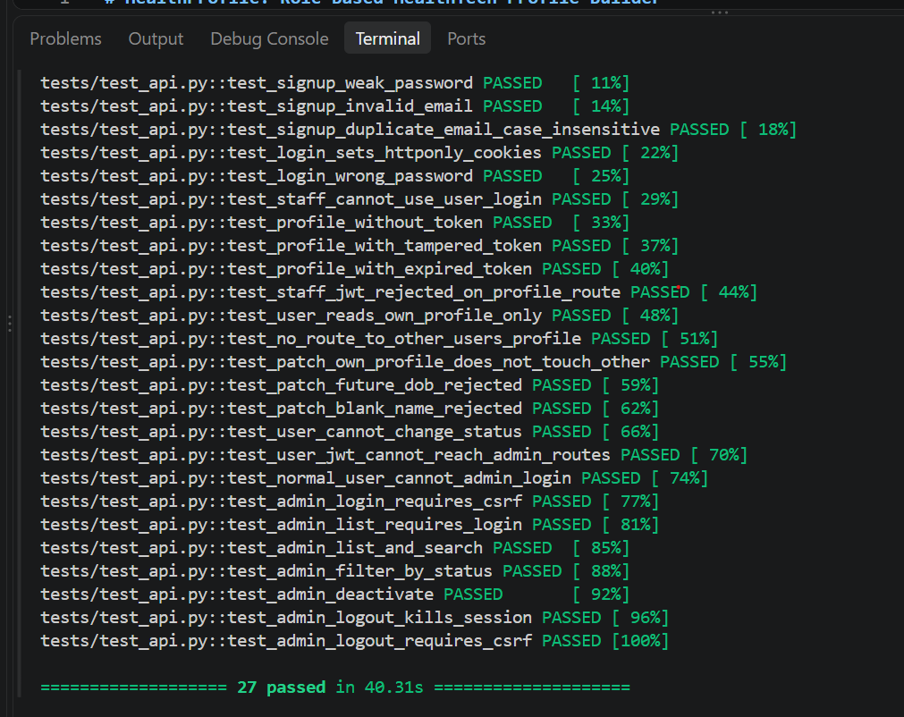

# HealthProfile: Role-Based HealthTech Profile Builder

Elevate Engine, Week 1 (Full-Stack AI/ML). A small HealthTech profile builder with **two separate
authentication flows**:

- **Standard users** self-register and authenticate with **JWT** (stored in HttpOnly cookies).
- **Admins** are created by a management command and authenticate with **server-side sessions + CSRF**.

> All data is **synthetic**. No real patient data is collected. The app gives no medical diagnosis or advice.

## Problem statement
Health apps hold sensitive profile data, so access control has to be strict: a user must only reach
their own profile, and admin power must not be reachable with a normal user's token or by editing
frontend state.

## Features
- [x] User signup (case-insensitive unique email, validation, hashed password)
- [x] User login/logout with short-lived JWT access token (15 min) and refresh token (7 days) in HttpOnly cookies
- [x] View and partially edit **own** profile only (`/profiles/me`, no id in the URL)
- [x] Admin accounts created by `create_admin` management command (no public admin signup)
- [x] Admin session login/logout, CSRF protection, 30-minute session expiry
- [x] Admin dashboard: list, search, filter by status, pagination, view details, deactivate
- [x] Isolation: user JWT cannot reach admin routes; staff accounts cannot use the user login
- [x] Migrations, constraints, a justified composite index, EXPLAIN evidence
- [x] 6 synthetic seed profiles
- [x] 27 automated tests
- [x] Minimal Next.js frontend (register, login, profile, admin login, admin dashboard)

## Architecture



The Next.js server proxies `/api/*` to Django, so the browser only talks to one origin and cookies
work without CORS configuration.

### The two auth flows

| | Standard user | Admin |
|---|---|---|
| Creation | `POST /api/auth/signup` | `python manage.py create_admin` (reads `.env`) |
| Login | `POST /api/auth/user/login` | `POST /api/admin/login` |
| Credential | JWT access (15 min) + refresh (7 days) | Django session cookie (30 min) |
| Storage | HttpOnly, SameSite=Lax cookies | HttpOnly, SameSite=Lax `sessionid` |
| CSRF | Not needed for the JSON API (SameSite=Lax cookie) | Required (`X-CSRFToken` header) |
| Auth class | `CookieJWTAuthentication` | `SessionAuthentication` + `IsAdminUser` |
| Logout | Clears the cookies | Destroys the session on the server |
| Expiry | Access token expires; frontend refreshes once on 401 | Session expires server-side |

How they stay separate:
- Profile endpoints accept **only** the JWT cookie and reject `is_staff` accounts.
- Admin endpoints accept **only** a session and require `is_staff`.
- A user JWT therefore gets **403** on admin routes; admin credentials get **401** on the user login.
- Admin status is checked by the server on every request, so editing frontend state cannot grant admin access.
- DRF has no default authenticators and the default permission is `IsAuthenticated`, so a view that
  forgets to declare auth is locked, not open.

**Where tokens live and how they are sent:** in HttpOnly cookies set by the server. JavaScript cannot
read them, which removes the main XSS token-theft risk of `localStorage`. The browser sends them
automatically (`credentials: "include"`). When the access token expires (401), the frontend calls
`/api/auth/refresh` once and retries. JWT claims contain only the user id and standard fields; never
passwords or secrets.

## Technology choices
| Layer | Choice | Why |
|---|---|---|
| Backend | Django 6 + Django REST Framework | Built-in sessions, CSRF, password hashing, migrations |
| JWT | `djangorestframework-simplejwt` | Maintained, standard claims, expiry and refresh built in |
| Database | SQLite for local dev (PostgreSQL-compatible) | Zero setup for reviewers |
| Frontend | Next.js (App Router) + TypeScript | Recommended stack; rewrites give same-origin cookies |
| Tests | pytest + pytest-django | Fast and readable |

## Project structure
```
backend/
  config/        settings, root urls
  accounts/      custom User model, JWT cookie auth, admin session auth, create_admin command
  profiles/      HealthProfile model, user + admin endpoints, seed_profiles command
  tests/         pytest suite
frontend/        Next.js app
docs/            ai-workflow.md, er-diagram.md, explain.md, screenshots/
```

## Setup

### Prerequisites
Python 3.11+, Node.js 20+, Git.

### Backend
```bash
python -m venv .venv
# Windows PowerShell: .venv\Scripts\Activate.ps1      macOS/Linux: source .venv/bin/activate
pip install django djangorestframework djangorestframework-simplejwt python-dotenv pytest-django
cp .env.example .env        # then edit the values
cd backend
python manage.py migrate
python manage.py create_admin
python manage.py seed_profiles
python manage.py runserver
```

### Frontend
```bash
cd frontend
npm install
npm run dev                 # http://localhost:3000  (use localhost, not 127.0.0.1)
```

### Environment variables (`.env.example`)
| Variable | Purpose |
|---|---|
| `DJANGO_SECRET_KEY` | Signs sessions and JWTs. Generate: `python -c "import secrets; print(secrets.token_urlsafe(50))"` |
| `DJANGO_DEBUG` | `True` locally. When `False`, cookies get the `Secure` flag |
| `ADMIN_EMAIL`, `ADMIN_PASSWORD` | Used only by `create_admin` |
| `BACKEND_URL` (frontend, optional) | Defaults to `http://127.0.0.1:8000` |

No real `.env` is committed.

### Demo accounts (synthetic)
- Users: `sara.malik@example.com`, `omar.siddiqui@example.com`, `layla.hassan@example.com`,
  `daniel.reyes@example.com`, `mei.tanaka@example.com` (inactive), `ayesha@example.com`
- Seeded user password: `Demo!Pass2026`
- Admin: the `ADMIN_EMAIL` / `ADMIN_PASSWORD` from your `.env`

## Tests
```bash
cd backend
python -m pytest -v
```
27 tests cover: valid and invalid signup, weak password, case-insensitive duplicate email, password
hashing, cookie flags, wrong password, staff blocked from the user login, missing / tampered / expired
JWT, staff JWT rejected, cross-user isolation, input validation, read-only `status`, user JWT against
admin routes, admin login requires CSRF, admin list / search / filter / deactivate, and logout killing the session.

## API reference
Base path: `/api`. Samples below (no Swagger in Week 1).

| Method | Path | Auth | Description |
|---|---|---|---|
| POST | `/auth/signup` | none | Create user (also creates a profile) |
| POST | `/auth/user/login` | none | Set JWT cookies |
| POST | `/auth/refresh` | refresh cookie | New access cookie |
| POST | `/auth/logout` | none | Clear JWT cookies |
| GET | `/profiles/me` | user JWT | Own profile |
| PATCH | `/profiles/me` | user JWT | Partial update of own profile |
| GET | `/admin/csrf` | none | Sets the `csrftoken` cookie |
| POST | `/admin/login` | CSRF | Start admin session |
| POST | `/admin/logout` | admin session + CSRF | End session |
| GET | `/admin/profiles?search=&status=&page=` | admin session | Paginated list |
| GET | `/admin/profiles/{id}` | admin session | Profile details |
| PATCH | `/admin/profiles/{id}/deactivate` | admin session + CSRF | Set status to inactive |

### Samples
**Signup** `POST /api/auth/signup`
```json
{"name":"Ayesha Khan","email":"ayesha@example.com","password":"Str0ng!Pass2026"}
```
`201`
```json
{"id":1,"name":"Ayesha Khan","email":"ayesha@example.com"}
```
Duplicate email: `400` `{"email":["A user with this email already exists."]}`

**User login** `POST /api/auth/user/login` returns `200` with the user, plus
`Set-Cookie: access_token=...; HttpOnly; Max-Age=900; Path=/; SameSite=Lax` and
`Set-Cookie: refresh_token=...; HttpOnly; Max-Age=604800; Path=/api/auth/; SameSite=Lax`.
Wrong password or an admin account: `401` `{"detail":"Invalid email or password."}`

**Update own profile** `PATCH /api/profiles/me`
```json
{"wellness_goals":"Walk 30 minutes daily","contact_preference":"phone"}
```
`200`
```json
{
  "id": 1, "full_name": "Ayesha Khan", "date_of_birth": null,
  "contact_preference": "phone", "wellness_goals": "Walk 30 minutes daily",
  "allergies": "", "emergency_contact_name": "", "emergency_contact_phone": "",
  "lifestyle_notes": "", "status": "active",
  "created_at": "2026-10-19T14:13:40Z", "updated_at": "2026-10-20T02:48:45Z"
}
```
Invalid value: `400` `{"date_of_birth":["Date of birth cannot be in the future."]}`
No or expired token: `401` `{"detail":"Authentication credentials were not provided."}`

**Admin list** `GET /api/admin/profiles?search=ayesha&status=active` returns `200`
```json
{"count":1,"next":null,"previous":null,
 "results":[{"id":1,"full_name":"Ayesha Khan","user_email":"ayesha@example.com","status":"active"}]}
```
(Results also include the other profile fields.) Admin routes without a valid session return
**403** (DRF session auth has no 401 challenge); user routes without a valid token return **401**.

## Database design
See [`docs/er-diagram.md`](docs/er-diagram.md) and [`docs/explain.md`](docs/explain.md).

- `accounts_user`: custom email-login user, unique constraint on `lower(email)`, role = `is_staff`, PBKDF2 password hash.
- `profiles_healthprofile`: one-to-one with the user (`ON DELETE CASCADE`), status, timestamps.
- `django_session`: framework-managed admin sessions.

| Index / constraint | Why it exists |
|---|---|
| `uniq_user_email_lower` | Login lookup and case-insensitive duplicate prevention |
| `idx_profile_status_created` (`status`, `-created_at`) | Admin list: filter by status, newest first |
| unique `user_id` (from the one-to-one) | `GET /profiles/me` lookup |

EXPLAIN (SQLite): `SEARCH profiles_healthprofile USING INDEX idx_profile_status_created (status=?)`.

A `full_name` index was evaluated and removed: admin search uses `icontains` (`LIKE '%x%'`), which a
B-tree index cannot serve. On PostgreSQL a `pg_trgm` index would be the fix.

## Security notes
- Passwords are hashed (PBKDF2) and never returned; every login failure returns the same message
- HttpOnly + SameSite=Lax cookies; `Secure` is added when `DEBUG=False`
- CSRF is enforced for admin session writes
- Ownership by design: no profile id in user routes
- `status` is read-only for users
- Secrets only in environment variables; `.env` is git-ignored

## AI-assisted workflow
See [`docs/ai-workflow.md`](docs/ai-workflow.md): prompt iterations, security review, context and
blast-radius management, bugs and fixes, verification.

## Limitations
- Logout clears cookies, but refresh tokens are not blacklisted; a stolen refresh token stays valid until it expires
- Deactivating a profile changes the profile status only; the user account can still log in
- No email verification, password reset, rate limiting or account lockout
- Admin actions are not audit-logged yet
- SQLite and the Django dev server are for local use, not production
- No Swagger/OpenAPI; examples are in this README

## Screenshots
| Screen | Image |
|---|---|
| Register / login |  |
| User profile |  |
| Admin dashboard |  |
| User JWT rejected on admin route (403) |  |
| Tests passing |  |